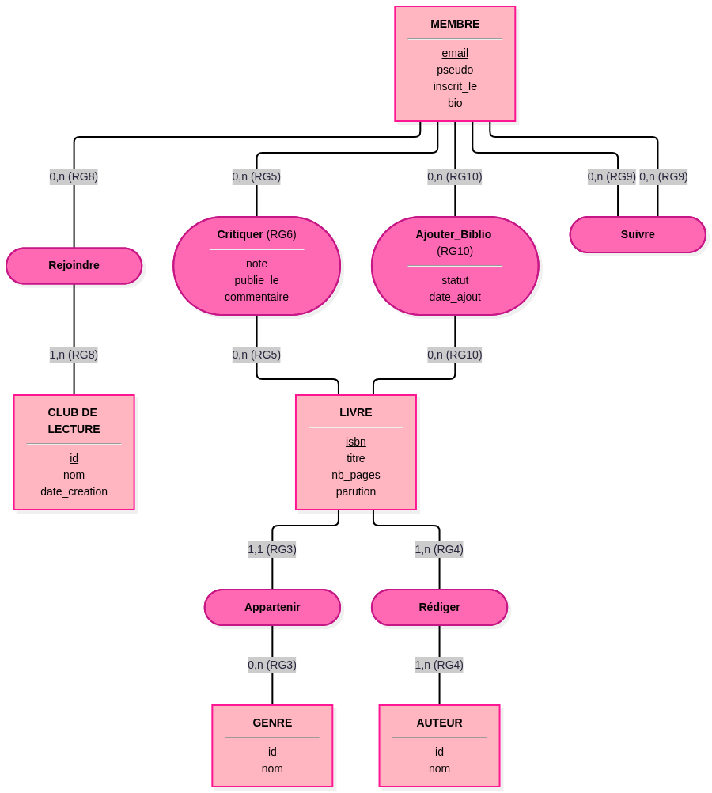

# Conception du Réseau de Lecteurs

### 1. Le cahier des charges

#### Règles de gestion

**RG1 :** Un membre est identifié par une adresse e-mail, unique sur la plateforme. Il possède toujours un pseudonyme (mail ou autre) et une date d'inscription, et facultativement une biographie.

**RG2 :** Un livre est identifié par son code ISBN (unique). Il possède toujours un titre, un nombre de pages, un synopsis et une date de parution.

**RG3 :** Un livre appartient à exactement un genre littéraire principal (ex: Science-Fiction, Romance). Un genre peut classifier aucun ou plusieurs livres.

**RG4 :** Un livre est écrit par au moins un auteur, et peut être écrit par plusieurs auteurs. Un auteur enregistré dans la base a écrit au moins un livre.

**RG5 :** Un membre peut donner son avis sur un livre en publiant une critique. Il écrit au plus une critique par livre. Un livre reçoit aucune, une ou plusieurs critiques.

**RG6 :** Une critique contient toujours une note de 1 à 5, toujours une date de publication, et un texte de commentaire facultatif.

**RG7 :** Les membres peuvent se regrouper. Un club de lecture est identifié par un id technique. Il possède toujours un nom (unique) et une date de création.

**RG8 :** Un membre peut rejoindre aucun, un ou plusieurs clubs de lecture. Un club de lecture contient toujours au moins un membre (son fondateur).

**RG9 :** Pour l'aspect social, un membre peut suivre aucun, un ou plusieurs autres membres pour voir leur activité. Un membre peut être suivi par aucun, un ou plusieurs membres.

**RG10 :** Un membre peut ajouter un livre à sa bibliothèque personnelle. Ce faisant, il doit toujours renseigner un statut de lecture (ex: « à lire », « en cours », « lu ») et une date d'ajout.

### Questions au métier posées lors de la conception

**Question 1 :** Un auteur peut-il exister seul dans la base s'il n'a aucun livre référencé sur notre plateforme ?

**Réponse retenue :** Non. Nous avons décidé qu'un auteur n'est créé que s'il est rattaché à un livre. C'est ce qui justifie le « au moins un » du côté de l'auteur dans la RG4.

**Question 2 :** Si un membre supprime son compte, que deviennent ses critiques ?

**Réponse retenue :** Pour ne pas fausser la note moyenne d'un livre qui a été calculée dans le temps, les critiques restent, mais le compte de l'auteur de la critique passera en « Utilisateur supprimé ». Le MLD devra en tenir compte (pas de suppression en cascade dure).

## 2. Modèle Conceptuel des Données (MCD)

Voici le Modèle Conceptuel des Données de notre réseau de lecteurs.
Conformément aux attentes du cahier des charges, chaque cardinalité est strictement appuyée sur une règle de gestion (indiquée entre parenthèses). Les associations `Critiquer` et `Ajouter_Biblio` sont porteuses de données.

## 3. Modèle Logique des Données (MLD) pour PostgreSQL

Suite à notre ADR, notre base de vérité est PostgreSQL. Voici la traduction de notre MCD en tables relationnelles (les clés primaires sont soulignées, les clés étrangères sont précédées d'un `#`).

**Entités traduites en tables simples :**
* `MEMBRES` (<u>email</u>, pseudo, inscrit_le, bio)
* `LIVRES` (<u>isbn</u>, titre, nb_pages, parution, note_moyenne) *(Note : la colonne `note_moyenne` est une dénormalisation justifiée dans notre ADR).*
* `GENRES` (<u>id</u>, nom)
* `AUTEURS` (<u>id</u>, nom)
* `CLUBS` (<u>id</u>, nom, date_creation)

**Traduction des associations (Justifications) :**

* **Appartenir** : Devient une clé étrangère `#genre_id` dans la table `LIVRES`.
    * *Pourquoi ?* Selon les règles de passage (Séance 1), l'association possède une cardinalité `1,1` du côté de Livre.
* **Rédiger** : Devient une table `LIVRE_AUTEUR` (<u>#livre_isbn</u>, <u>#auteur_id</u>).
    * *Pourquoi ?* L'association est `1,n - 1,n` (aucun 1,1). Elle devient une table dont la clé primaire est composée des deux clés étrangères.
* **Critiquer** : Devient une table `CRITIQUES` (<u>#membre_email</u>, <u>#livre_isbn</u>, note, publie_le, commentaire).
    * *Pourquoi ?* Association `0,n - 0,n` (aucun 1,1), elle devient une table. La clé primaire composée garantit nativement la RG5 ("au plus une critique par livre pour un membre").
* **Rejoindre** : Devient une table `MEMBRE_CLUB` (<u>#membre_email</u>, <u>#club_id</u>).
    * *Pourquoi ?* Association `0,n - 1,n` (aucun 1,1), elle devient une table de jointure.
* **Ajouter_Biblio** : Devient une table `BIBLIOTHEQUE` (<u>#membre_email</u>, <u>#livre_isbn</u>, statut, date_ajout).
    * *Pourquoi ?* Association `0,n - 0,n` (aucun 1,1), elle devient une table de jointure qui porte les données de l'association.
* **Suivre** : Devient une table `ABONNEMENTS` (<u>#suiveur_email</u>, <u>#suivi_email</u>).
    * *Pourquoi ?* Association réflexive `0,n - 0,n`, elle devient une table liant deux fois la table `MEMBRES`.

## 4. Ce que le schéma ne garantit pas

Une base de données relationnelle ne peut pas garantir toutes nos règles de gestion nativement via son schéma. Voici ce qui échappe au MPD et où nous le garantissons :

1. **RG4 ("Un livre est écrit par au moins un auteur")** : PostgreSQL ne peut pas obliger l'insertion d'une ligne dans `LIVRE_AUTEUR` au moment de la création du `LIVRE`.
    * *Où on le garantit :* Dans le code de l'application (l'API), via une **transaction SQL** qui insère le livre et son/ses auteur(s) simultanément. Si l'auteur manque, la transaction échoue (Rollback).
2. **RG8 ("Un club de lecture contient toujours au moins un membre")** : Même problème que pour les auteurs.
    * *Où on le garantit :* Dans le code applicatif, lors de la route de création d'un club, le membre créateur est automatiquement ajouté dans `MEMBRE_CLUB` dans la même **transaction**.
3. **La dénormalisation de `note_moyenne`** : Le schéma ne met pas à jour cette colonne tout seul quand une critique est publiée.
    * *Où on le garantit :* Via un **Trigger (déclencheur) PostgreSQL** qui se déclenchera automatiquement après chaque `INSERT`, `UPDATE` ou `DELETE` sur la table `CRITIQUES` pour recalculer la moyenne du livre concerné.